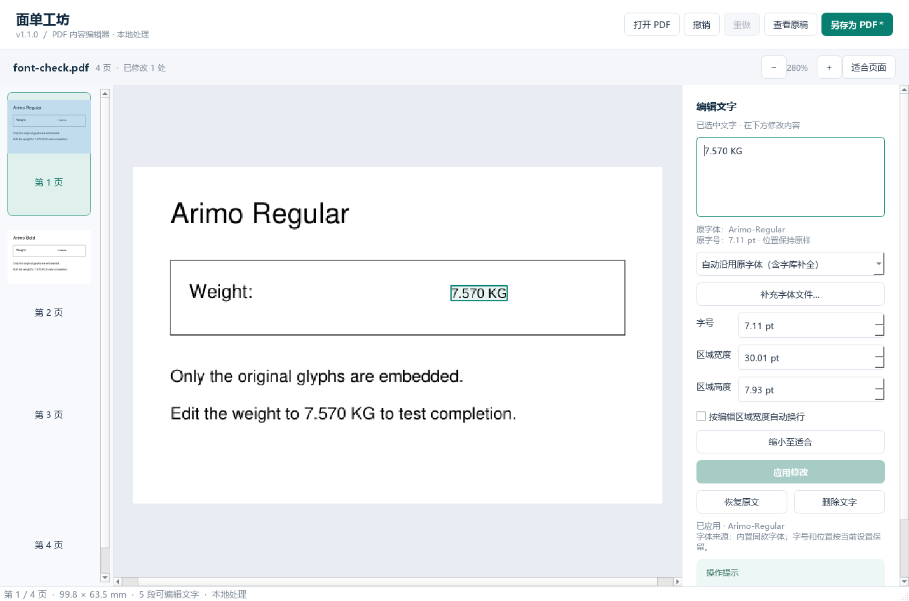

# Label Editor 1.2 · 面单工坊

[简体中文](README.md) | **English**

A local desktop PDF text editor for Windows and macOS, designed for text-based shipping labels. Import a PDF, select text, edit it, and save a new PDF. Your documents stay on your computer.

The application currently has a Chinese interface. This introduction and the tutorials are available in both English and Chinese; the English guide includes a button glossary.

## Download

Open the [latest release](https://github.com/LoriZhang2026/label-editor/releases/latest) and choose an asset:

| Computer | File |
| --- | --- |
| Windows 10 / 11, 64-bit | `LabelEditor-Windows-x64-v1.2.0.zip` |
| Apple Silicon Mac (M series), macOS 15 or later | `LabelEditor-macOS-arm64-v1.2.0.zip` |
| Intel Mac, macOS 15 or later | `LabelEditor-macOS-x86_64-v1.2.0.zip` |

Windows: extract the entire ZIP and launch `LabelEditor/LabelEditor.exe`. Keep the `_internal` folder beside the executable. Mac: extract the ZIP, move `LabelEditor.app` to Applications, and open it. No Python installation or account is required. GitHub's automatically generated **Source code** archives are for developers.

The Mac build is ad-hoc signed, without an Apple Developer ID or notarization. Gatekeeper may block the first launch. Review the source and checksum, then follow the [Mac installation guide](docs/guide.en.md#mac-installation). Do not disable system security protections.

[User guide](docs/guide.en.md) · [FAQ](docs/faq.en.md) · [Release history](docs/changelog.en.md) · [Build and publish](docs/publishing.en.md)

## Quick start

1. Drag a PDF into the window or click **打开 PDF** (Open PDF).
2. Click the text you want to change, then type in the right panel.
3. Keep **自动沿用原字体（含字库补全）** (Automatically reuse the original font) selected.
4. Click **应用修改** (Apply), then **查看原稿** (View original) to compare.
5. Click **另存为 PDF** (Save as PDF). The original file is not overwritten.

## Original-font matching

The editor first reuses the embedded font. If a PDF contains only a subset of glyphs, it searches other pages, installed system/user fonts, and bundled fonts for the same face, matching family, weight, and italic style. Complete Arimo Regular, Bold, Italic, and Bold Italic fonts are included. Similar-looking Arial or Helvetica faces are not silently substituted for Arimo.

If the original font is unavailable or does not support the new characters, the application asks you to supply the font. Different versions with the same font name may still look different; check the exported document before printing.

## Features and limits

- Edit selectable horizontal text, including Chinese, Latin text and numbers; browse multiple pages and rotated pages.
- Preserve the original font size, color and baseline by default. Undo, redo and compare with the original.
- Remove the old text and insert the replacement without rasterizing the entire PDF or covering text with a white rectangle.
- Preserve images and vector lines; reject unsafe overlaps with neighboring text, graphics, links and annotations.
- Save as a new PDF, retaining page sizes, page count and encryption settings.
- No OCR editing of scanned images, restoration of outlined text, image replacement, independent text boxes, batch processing or direct printing.
- Barcodes and QR codes are not regenerated. Changing a visible tracking number does **not** change its encoded data.
- The sample label uses fictitious data and must not be used for shipping.

PDF encodings and drawing structures vary. Not every PDF can be edited faithfully. Review the result and test-print at actual size.

## Development

Python 3.12, PySide6, PyMuPDF and fontTools. Install `requirements-dev.txt` in a virtual environment and run `python -m pytest -q`.

Windows: `powershell -ExecutionPolicy Bypass -File build.ps1` (expects `.venv/Scripts/python.exe`). Mac: `python build_macos.py`. Build on the target operating system and CPU architecture. The macOS workflow runs independent Apple Silicon and Intel builds, regression tests, app self-tests and ZIP extraction checks.

## License and credits

Project source is licensed under [GNU AGPL v3](LICENSE). Third-party components keep their own licenses; distributions include the corresponding project source and notices. See [third-party components](THIRD_PARTY.md).

Arimo comes from the [official Google Fonts repository](https://github.com/googlefonts/Arimo). Its OFL license, pinned revision and checksums are included in `assets/fonts/Arimo/`. The font fetch script is a development tool; the application does not download fonts or upload PDFs.
