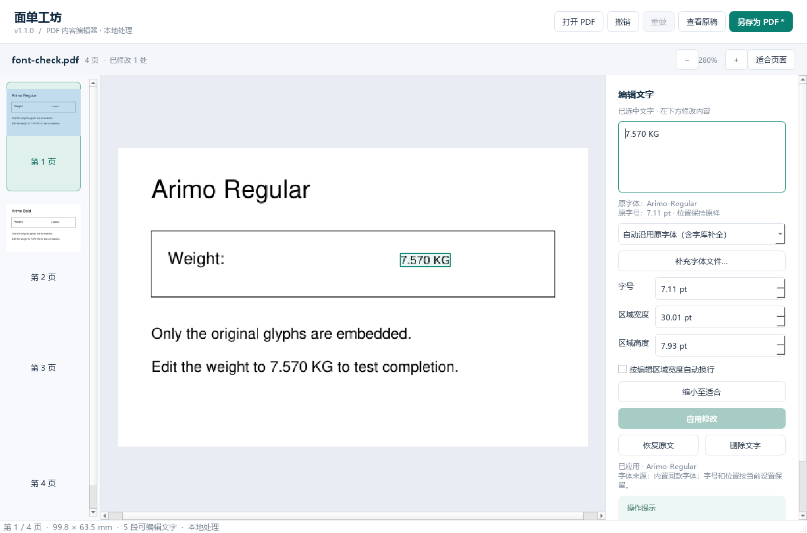

# 面单工坊 1.1 · Windows PDF 内容编辑器

本地运行的 Windows 10 / 11 64 位桌面应用，适合修改文字型电商面单。文件不会上传到服务器。



## 下载与快速开始

打开 [最新版本下载页](https://github.com/LoriZhang2026/label-editor/releases/latest)，在 **Assets** 中下载 `LabelEditor-Windows-x64-v1.1.0.zip`。GitHub 自动生成的 `Source code` 压缩包是源码，不是可直接运行的程序。

解压整个压缩包，打开 `LabelEditor` 文件夹，双击 `LabelEditor.exe`。无需安装 Python，也无需登录账号。

文档：[详细操作步骤](docs/使用指南.md) · [常见问题](docs/常见问题.md) · [更新记录](CHANGELOG.md) · [构建与发布](docs/GitHub发布指南.md)

## 启动

双击项目目录中的 `启动面单工坊.cmd`，或运行 `dist/LabelEditor/LabelEditor.exe`。
发布版本无需安装 Python。移动到其他电脑时，请复制整个 `LabelEditor` 文件夹，不能只复制 exe。

## 使用

1. 拖入 PDF，或点击「打开 PDF」。首页附带一份虚构的示例面单。
2. 点击页面里的文字，在右侧修改内容。每个选区是一段具有相同样式的文字。
3. 默认自动沿用原字体、字号、颜色和文字基线。嵌入字体缺字时，自动检查 PDF 其他页面、本机字体和内置同款字库，保持原字体家族、字重和斜体样式，无需手动选择。应用后显示实际字体来源。
4. 内容过长时，调整编辑区域宽高、勾选自动换行，或点击「缩小至适合」。宽高以 PDF 点为单位：72 pt = 25.4 mm。修改宽高不会移动文字，也不会自动缩小字体。
5. 点击「应用修改」，确认页面中的实际效果；点击「查看原稿」可切换对比。编辑边框不会出现在导出文件中。
6. 点击「另存为 PDF」。原文件不会被覆盖，另存时保留页数、页面尺寸和加密设置。

删除文字：清空编辑框或点击「删除文字」，然后应用。恢复原文：点击「恢复原文」。撤销和重做使用顶部按钮；编辑框内的 Ctrl+Z 用于撤销正在输入的文字。

快捷键：Ctrl+O 打开，Ctrl+S / Ctrl+Shift+S 另存为，Ctrl+Enter 应用，Alt+Left / Alt+Right 撤销/重做文档修改，Ctrl+滚轮缩放。

## 当前支持范围

- 文字型 PDF 中可安全选取的横排文字；支持中文、英文、数字和多页文件，也支持页面整体旋转。
- 优先复用嵌入字体；子集字形不够时自动寻找同款字体。内置完整 Arimo 的常规、粗体、斜体、粗斜体字库，支持截图中重量字段新增数字、句点及 KG 等字符。字体检测不把 Arial、Helvetica 等相似字体当成 Arimo。
- 自动识别 Windows 系统及当前用户安装的字体，并正确选择 TTC 字体集合中的对应字体。程序运行时无需联网。
- 若原字体的完整字库在文件、本机和内置资源中都不存在，则无法凭空生成缺失字形，会明确提示提供该字体，不会静默切换到其他字体。同名字体若存在不同发行版本，仍需对实际 PDF 做视觉核对。
- 真实移除选中的旧文字并写入新文字，不使用白色矩形覆盖旧文字，不将整个 PDF 转成图片。
- 原图像和矢量线条不参与文字删除。会阻止新文字与其他文字、图片、深色图形、批注或链接重叠。
- 扫描件、隐藏识别层、竖排/旋转文字、数字签名文件和禁止修改的文件暂仅支持查看。含未处理涂黑批注的页面不允许编辑。
- 本版不生成或重编码条码/二维码；修改单号文字不会更新扫码内容。示例面单为虚构数据，不能用于寄件。
- 暂不支持批量修改、新增独立文本框、移动文字、图片替换或直接打印。导出的 PDF 可用常用阅读器按实际大小打印。

由于 PDF 字体编码和文字绘制方式差异，无法保证每份 PDF 都可以原样编辑。遇到不支持的结构会给出提示；请在导出前查看修改稿，实际面单应试打一张确认。

## 开发与构建

Python 3.12，PySide6 桌面界面，PyMuPDF 文档引擎。

```powershell
python -m venv .venv
.venv/Scripts/python.exe -m pip install -r requirements-dev.txt
.venv/Scripts/python.exe scripts/make_sample.py
.venv/Scripts/python.exe main.py
.venv/Scripts/python.exe -m pytest -q
powershell -ExecutionPolicy Bypass -File build.ps1
```

编辑引擎：`label_editor/core.py`；界面：`label_editor/ui.py`；回归测试：`tests/`。
测试覆盖原文件保留、修改区域之外的像素一致性、字体缺字、字体复用、撤销重做、溢出与重叠拦截、加密、多页和页面旋转。

项目源码采用 [GNU AGPL v3](LICENSE)。项目包含 PyMuPDF、PySide6 等第三方组件；各组件遵循其自身许可证。分发包内附第三方许可证及本项目源代码。依赖来源见 [第三方组件说明](THIRD_PARTY.md)。

Arimo 字库来自 [Google Fonts Arimo 官方仓库](https://github.com/googlefonts/Arimo)，原始文件、OFL 许可证、固定提交版本和校验值位于 `assets/fonts/Arimo/`。`scripts/fetch_arimo.py` 仅用于开发阶段获取字体，应用本身不下载字体或上传 PDF。
