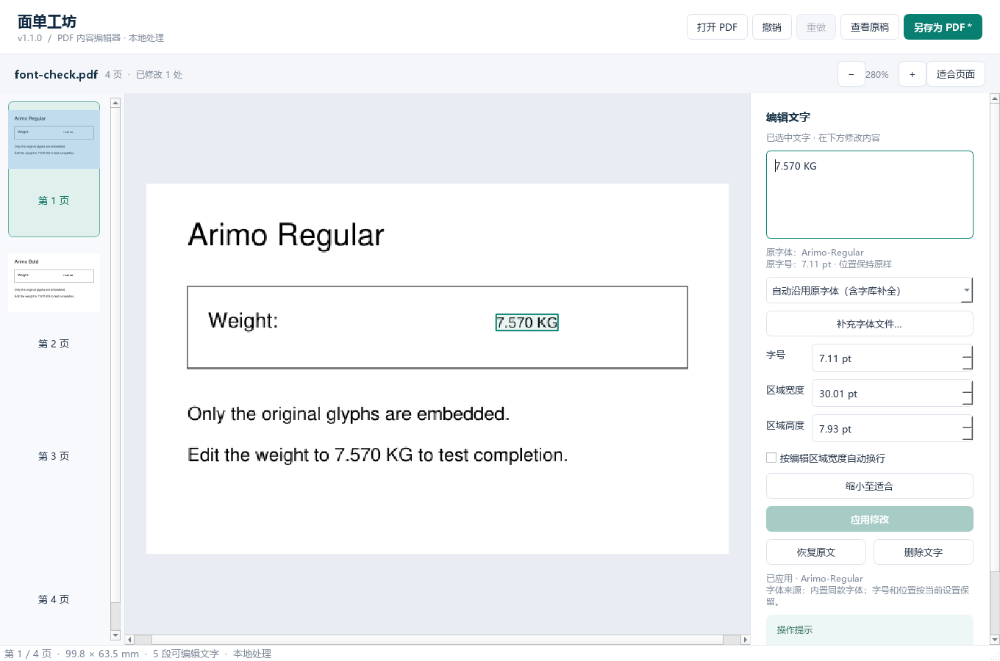

# User guide

[简体中文](使用指南.md) | **English**

## 1. Download and launch

Download the appropriate ZIP from [Releases](https://github.com/LoriZhang2026/label-editor/releases/latest). No Python installation or login is required. Documents are processed locally.

Windows 10 / 11 x64: extract the entire archive and launch `LabelEditor.exe` inside the `LabelEditor` folder. Keep `_internal` beside it. Do not launch the application from inside the ZIP viewer.

### Mac installation

Check **About This Mac**. For an Apple M-series chip, choose `macOS-arm64`; for an Intel processor, choose `macOS-x86_64`. This version targets macOS 15 or later.

Extract the archive, move `LabelEditor.app` into Applications, then open it. You can keep the accompanying bilingual documentation and source elsewhere.

This build uses an ad-hoc signature; it is not Developer ID signed or notarized by Apple. If the first launch is blocked, first verify the GitHub source and SHA-256 checksum. If you trust the download, follow [Apple's official instructions](https://support.apple.com/en-us/102445) to use **System Settings → Privacy & Security → Open Anyway**. Managed computers may prohibit this. Do not disable Gatekeeper or system security protections.

The Mac app searches system, shared and user font directories. A Windows font used by your PDF may not be installed on a Mac. Install a licensed copy of the same font or supply its font file; the editor does not automatically substitute PingFang or another family.

## 2. Open a PDF

Click **打开 PDF** (Open PDF) or drag a PDF into the window. Choose pages in the left sidebar. Use **适合页面** (Fit page) or Ctrl + mouse wheel on Windows / Command + mouse wheel on Mac to zoom.

Try the fictitious sample first. Scanned images and text converted to outlines cannot be selected as editable text in this version.

## 3. Edit text with its original font

Click the text on the page and change its contents in the right panel. Selection follows the PDF's internal text spans, so a visual line may contain several editable pieces.

Keep **自动沿用原字体（含字库补全）** selected. The application tries the PDF's own font first, then the same face on other pages, installed fonts and bundled fonts. Family, weight and italic style must match. Complete Arimo Regular, Bold, Italic and Bold Italic faces are included.

For example, changing `7.340 KG` to `7.570 KG` can use the complete Arimo font when the PDF subset lacks the new digit. After applying, the panel shows the font actually used and where it came from.

If the same complete font cannot be found, use **补充字体文件…** (Supply font file) or install it and restart. A font cannot gain characters it never supported; for example, Arimo does not contain Chinese glyphs. The automatic setting does not silently switch families.

## 4. Apply and compare

Click **应用修改** (Apply) or press Ctrl + Enter / Command + Enter. Use **查看原稿** (View original) to compare letter shapes, position, line breaks and nearby content.

For overflowing text, check the replacement, widen or heighten the editing region, or enable wrapping. **缩小至适合** (Shrink to fit) changes the font size, so avoid it when the original size must remain unchanged. New text cannot overlap a neighboring barcode, image or text span.

Use **恢复原文** (Restore original) for the selected span, or the top undo/redo controls for applied document changes. Clearing the field or using **删除文字** (Delete text), then applying, removes the selected text.

## 5. Save and print

Click **另存为 PDF** (Save as PDF) and choose a new filename. The source file is not overwritten. Open the result in a PDF reader, check it, and test-print at actual size / 100%.

Changing a visible tracking number does not update the barcode or QR data. Generate a new label through the ecommerce or logistics system if its encoded data must change.

## Button glossary

| Chinese label | Meaning |
| --- | --- |
| 打开 PDF | Open PDF |
| 应用修改 | Apply changes |
| 查看原稿 | View original |
| 另存为 PDF | Save as PDF |
| 自动沿用原字体（含字库补全） | Automatically reuse original font, completing missing glyphs |
| 补充字体文件… | Supply a font file |
| 字号 / 区域宽度 / 区域高度 | Font size / region width / region height |
| 按编辑区域宽度自动换行 | Wrap text to region width |
| 缩小至适合 | Shrink to fit |
| 恢复原文 / 删除文字 | Restore original / delete text |
| 撤销 / 重做 / 适合页面 | Undo / redo / fit page |

## Shortcuts

| Action | Windows | Mac |
| --- | --- | --- |
| Open | Ctrl + O | Command + O |
| Save as | Ctrl + S or Ctrl + Shift + S | Command + S or Command + Shift + S |
| Apply | Ctrl + Enter | Command + Enter |
| Document undo / redo | Alt + Left / Right | Option + Left / Right |
| Zoom | Ctrl + wheel | Command + wheel |
| Undo text being typed | Ctrl + Z | Command + Z |
