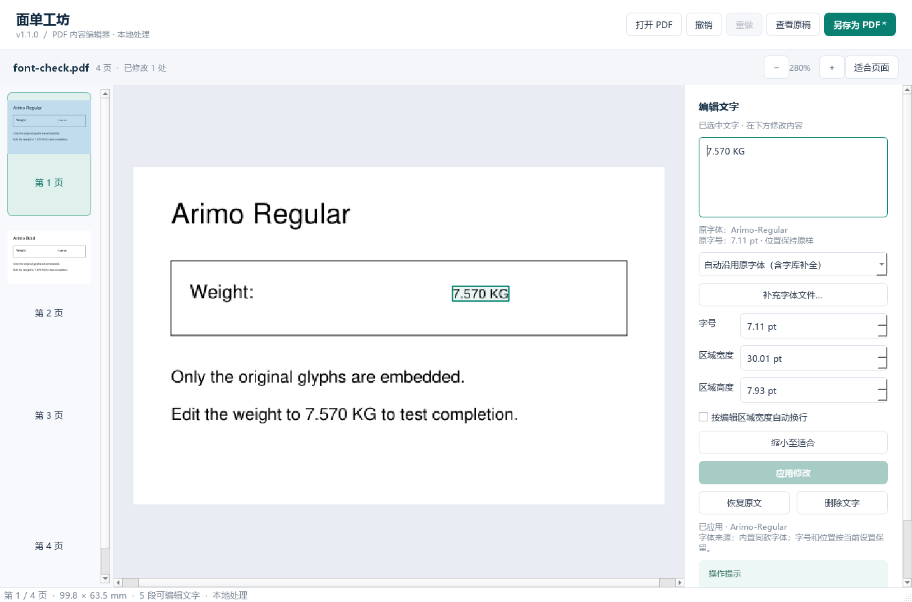

# 面单工坊操作指南

## 1. 下载并启动

在项目的 Releases 页面下载 Windows x64 的 ZIP 安装包，完整解压后双击 `LabelEditor.exe`。请保留旁边的 `_internal` 文件夹；只复制 EXE 会导致无法启动。

首次使用可以打开软件内的虚构示例面单熟悉操作。应用处理 PDF 时无需联网，也不会上传面单。

## 2. 导入面单

点击右上角「打开 PDF」，或者把 PDF 拖入窗口。多页面单可在左侧选择页面。可点击「适合页面」，或使用 Ctrl + 鼠标滚轮缩放查看。

本版编辑文字型 PDF。如果整张面单是一张扫描图片，或者文字已经转换为图形，软件无法把它作为原文字直接编辑。

## 3. 选择并修改文字

点击页面中需要修改的文字，在右侧输入新内容。选区按照 PDF 内部的文字片段划分，一行可能需要分段编辑。

字体默认保持「自动沿用原字体（含字库补全）」。无需手动选择相似字体：程序首先复用 PDF 原字体，缺字时检查其他页面、Windows 已安装字体和内置同款字库。内置 Arimo 的常规、粗体、斜体、粗斜体四种样式。

例如将 `7.340 KG` 改成 `7.570 KG`，即使原 PDF 只嵌入了部分数字，程序也会尝试自动补齐同款字体。应用后的提示会显示实际字体来源。

若提示找不到同款完整字体，请安装原字体，或点击「补充字体文件…」提供同款字体。字体原本不支持的文字无法通过补全生成，例如 Arimo 不包含中文字形。软件不会自动将其替换成其他字体家族。

## 4. 应用并对比

点击「应用修改」，或按 Ctrl + Enter。点击「查看原稿」对比修改前后的页面，确认字形、位置、换行和周边内容。

如果文字超出区域，优先检查输入内容；需要时增加区域宽高或勾选自动换行。要求字号完全不变时，不要使用「缩小至适合」，该按钮会缩小字号。增大区域也不能覆盖旁边的文字、条码或图片。

「恢复原文」恢复选区原有内容；顶部「撤销」「重做」作用于已应用的文档修改。

## 5. 另存并打印

点击「另存为 PDF」，选择新文件名。软件不覆盖原文件。保存后用常用 PDF 阅读器查看，打印选择实际尺寸／100%，先试打一张检查排版与扫码。

本版不重新生成条码或二维码。修改单号的可见文字不会同步改变扫码内容；需要更新扫码数据时应使用对应电商或物流系统重新生成面单。

## 快捷键

| 操作 | 快捷键 |
| --- | --- |
| 打开 PDF | Ctrl + O |
| 另存为 PDF | Ctrl + S / Ctrl + Shift + S |
| 应用当前修改 | Ctrl + Enter |
| 撤销／重做文档修改 | Alt + Left / Alt + Right |
| 缩放页面 | Ctrl + 滚轮 |

编辑框内的 Ctrl + Z 只撤销尚在输入的文字。
